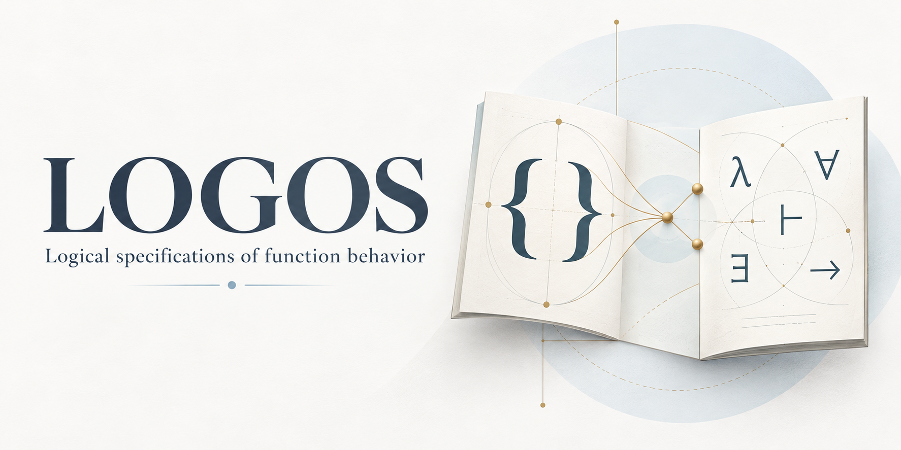

# LOGOS: LLM-Based Generation of Function Contracts for C

**LOGOS** takes its name from the Greek [λόγος (*logos*)](https://logeion.uchicago.edu/%CE%BB%CF%8C%CE%B3%CE%BF%CF%82),
meaning “reason” or “account.” The name reflects its purpose: generating logical
specifications of function behavior as ACSL contracts for C.

LOGOS provides a skill for authoring ACSL function contracts and a Python wrapper
that inserts those contracts into C source and optionally verifies the result
with Frama-C WP. The agent decides contract semantics; the wrapper handles
rendering, annotation, verification, and reports.

The input must already contain ACSL. Input programs, case studies, generated
contracts, annotated source, and proof reports belong in external project
directories and are not distributed in this repository.

## Choose a Workflow

For AutoDeduct integration, start with the
[AutoDeduct LLM branch](https://github.com/rse-verification/auto-deduct/tree/llm-skill-mode)
and its [setup and usage guide](https://github.com/rse-verification/auto-deduct/blob/llm-skill-mode/docs/LLM.md).
AutoDeduct calls LOGOS to generate contracts, apply them, verify with Frama-C,
and consume the verification report.

| Workflow | How it runs | Guide |
|---|---|---|
| [AutoDeduct LLM with local tools](https://github.com/rse-verification/auto-deduct/tree/llm-skill-mode) | Host Codex uses the local LOGOS skill; AutoDeduct runs the wrapper and Frama-C locally | [AutoDeduct local setup](https://github.com/rse-verification/auto-deduct/blob/llm-skill-mode/docs/LLM.md#local-verification-dependencies) |
| [AutoDeduct LLM with Docker verification](https://github.com/rse-verification/auto-deduct/tree/llm-skill-mode) | AutoDeduct extracts the image's skill for host Codex, then runs the wrapper and Frama-C in Docker | [AutoDeduct Docker setup](https://github.com/rse-verification/auto-deduct/blob/llm-skill-mode/docs/LLM.md#run-with-docker-verification) |
| Standalone LOGOS | Ask Codex to author contracts, then apply and optionally verify them with the local wrapper | [Standalone usage](docs/USAGE.md) |

AutoDeduct's LLM workflow runs Codex on the host. Running Codex inside its
container is unsupported. Docker is optional when verification dependencies are
installed locally.

## Documentation

- [Setup](docs/SETUP.md): Python, libclang, verification tools, and platform support.
- [Standalone usage](docs/USAGE.md): agent prompts, contract files, and wrapper commands.
- [AutoDeduct integration](docs/AUTODEDUCT.md): host launcher, local/Docker runtimes, and the JSON handoff.
- [Verification and scope](docs/VERIFICATION.md): proof results, reports, limitations, and artifact policy.
- [Skill instructions](skill/SKILL.md): instructions and contract schema used by the agent.

## Repository Layout

- `skill/SKILL.md`: contract-generation skill.
- `skill/scripts/generate_acsl.py`: Python wrapper entry point.
- `skill/scripts/acsl_tool/`: parsing, rendering, annotation, and verification.
- `tests/`: automated checks.
- `scripts/measure_codex_contracts.py`: measurement utility.
- `docs/`: user guides.

## License

LOGOS's original software is licensed under the **GNU General Public License
v2.0 only** (`GPL-2.0-only`). See [LICENSE](LICENSE) for the full terms and
[NOTICE](NOTICE) for licensing scope and separately owned material.
